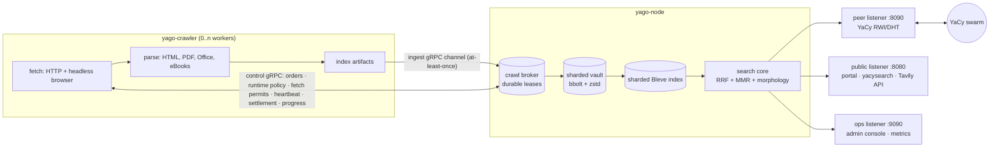

# YagoSeek

<p align="center"><b>Your own federated search engine — one Go binary away.</b></p>

<p align="center">
  
  
  
  
  
</p>

**YagoSeek** is a self-hosted, YaCy-compatible peer-to-peer search node written
in pure Go: run your own web index, join the federated YaCy swarm, crawl the
web with a hardened crawler, and query everything through a Tavily-compatible
Search API, YaCy-compatible endpoints, or a themeable public portal — all
administered from a server-rendered console that works without JavaScript.

**YagoSeek** is the product; **`yago`** is the toolkit — the Go workspace and
its binaries (`yago-node`, `yago-crawler`). Both binaries are built and tested
together, so upgrade a node and its crawlers to the same release.

- Project home: https://yagoseek.dev/ · docs: https://docs.yagoseek.dev/
- Source: https://github.com/D4rk4/yago/ — the importable Go modules are listed
  in [`go.work`](go.work)

> [!WARNING]
> **Alpha software.** Everything described below is implemented, covered by
> tests (unit, integration, and containerized end-to-end suites), and runs on
> real nodes — but the project is young and still needs broad, adversarial,
> real-world testing before you should trust it with anything critical.
> Expect rough edges, please report what you hit, and keep backups (there is
> a console page for that).

---

## ✨ What you get

### 🌐 A real YaCy peer

- Speaks the **YaCy RWI/DHT wire protocol**: hello handshake, seed lists
  (HTML/JSON/XML), inbound and outbound RWI/URL-metadata DHT transfers with
  sender-side gates, remote RWI search, host-link index, peer messages,
  profiles, and shared blacklists — interoperable with the Java YaCy network.
- Interoperability with stock Java peers is tested in both directions. An
  overloaded transfer receives a parseable YaCy overload answer instead of a
  silent partial acknowledgement, and inbound transfers are accepted only from
  senders already present in the peer roster.
- Outbound DHT transfers keep a live or restart-recoverable copy of every
  posting until all redundancy copies are accepted. Postings a target rejects
  are restored locally before any new attempt.
- **Swarm participation**: seedlist bootstrap, peer roster with birth-date
  promotion, LAN discovery, peer news, per-peer blocking, IPv6-only peers, and
  a DHT gates dashboard that shows exactly why a transfer would or would not
  fire. Peers that fail the callback check stay visible as `junior` but are
  never used for search, seed lists, or DHT targets.
- Peer messages and peer news are stored durably with fixed size and age
  limits; startup cleanup removes corrupt or expired records.
- Deliberate divergences are documented, not hidden — see
  [compatibility.md](yagonode/doc/compatibility.md).

### 🔍 Search that ranks, not just matches

- Three sources in one answer: the local index (sharded
  [Bleve](https://blevesearch.com/)), federated swarm fan-out, and optional web
  search. Results are merged with **reciprocal-rank fusion** and **MMR result
  diversity**, and a slow or failing branch never discards an answer another
  branch already completed.
- Web search (DDGS) is **off by default** and only an operator can enable it:
  `Disabled`, `Only when requested`, `Supplement below 100 results`, or
  `Always`. Local-only requests never reach it, every web row must match the
  query and its filters, and `safe_search=true` admits only rows with
  provider-filter evidence. Human-facing pages label these results `web`, and
  discovered URLs can optionally seed the crawler.
- **[YagoRank](yagonode/doc/yagorank.md)** — fielded BM25 with phrase and
  proximity evidence, persistent date, anchor, authority, quality, safety,
  duplicate-cluster, and peer-reputation signals, then a learned LambdaRank or
  LambdaMART model. A new model is promoted only after held-out evaluation, the
  console exposes 13 safe live ranking coefficients, and Search Explain traces
  every result back to its `local`, `peer`, or `web` source. Pure Go, CPU-only,
  no external API, sidecar, or YaCy wire change.
- **Language-aware lexical search**: per-language analyzers rank word forms
  below exact wording, Arabic receives normalization and light stemming, and
  Chinese, Japanese, and Korean are indexed as character unigrams and bigrams,
  with optional dictionary words for Chinese and Japanese.
- YaCy query operators (`site:`, `inurl:`, `filetype:`, `language:`, `tld:`,
  `author:`, `"phrase"`, `-not`, `near`, `/date`), facet sidebar, content
  verticals (images/audio/video/apps with a lightbox grid), spell-check
  ("did you mean"), zero-result fuzzy recovery, query-term-highlighted
  snippets, anchor-text document expansion, and an explainable ranking API.
- **Tavily-compatible `/search`, `/extract`, `/crawl`, and `/map`** with scoped
  API keys. Responses keep the standard Tavily shape: default results carry
  `raw_content: null` and errors carry only `detail.error`. Raw-content work
  runs under fixed concurrency, time, and memory budgets. A search that lost a
  source and found nothing answers HTTP 409 with `Retry-After: 1` instead of a
  false empty result.
- **Bounded search memory**: authority, spelling, and morphology statistics
  refresh in a background corpus pass that uses at most a tenth of wall time
  and survives restarts. A missing or outdated full-text index is rebuilt from
  the document store at startup.
- Search diagnostics record failure stages without query text, URLs,
  credentials, or peer identifiers.

### 🕷️ A crawler built for the hostile web

- Separate `yago-crawler` workers connect to the node over dedicated control
  and ingest gRPC channels with durable leased orders and backpressured
  at-least-once ingest. Either side can restart on its own: committed pages
  stay, and the crawler adopts its unfinished leases again.
- One live fleet-wide ceiling, `crawler.max_pages_per_second` (default 10, `0`
  for unlimited), limits page-fetch starts across every crawler and run.
- Configuration → Crawler owns the crawler runtime policy: redirects, depth,
  host concurrency, crawl delay, fetch timings, browser use, and shutdown
  grace. A change that cannot apply in place restarts the crawler gracefully.
- The node keeps the crawl queue, leases, and run state in one transactional
  store, `${YAGO_DATA_DIR}/crawlbroker.db`.
- The Admin Crawler page separates node orders from worker frontier URLs and
  shows bounded current and waiting URL samples with active stages.
- **Format coverage beyond HTML**: PDF, DOCX/XLSX/PPTX, legacy DOC/XLS/PPT,
  ODT/ODS/ODP, RTF, EPUB, plain text/CSV, and Markdown — parsed with
  stdlib-first parsers and validated against real files.
- **Two-tier fetching**: fast HTTP first, with a headless Firefox fallback (at
  most two long-lived processes) only for bot walls and JavaScript app shells
  with too little static text. Non-HTML never opens a browser, and both paths
  stay behind the SSRF egress guard.
- **Legacy-web text correctness**: browser-compatible charset decoding handles
  Windows-1251 and other WHATWG encodings, and language detection keeps
  documents, facets, RWI postings, and URL metadata aligned.
- Politeness and defense: robots.txt with the standard 500 KiB limit and a
  sanitizer for malformed files, per-host adaptive pacing and crawl delays, URL
  canonicalization, and early rejection of unsupported file types. A host that
  fails five times in a row is skipped for the rest of the run.
- **A living index**: pages are recrawled every 30 days by default, and a page
  that is permanently gone (404/410) leaves the index — no eternal dead links.
- Automatic discovery: swarm greedy-learning and opt-in web-discovery seeding
  use a small depth-1, 25-page profile. Their switches, depths, and page caps
  apply live without a restart.

### 🎨 A public portal your users can keep

- Server-rendered, **works without JavaScript**, accessible (skip links, ARIA,
  keyboard navigation), mobile-friendly, with OpenSearch browser integration
  and RSS/JSON output for every query.
- Every result shows up to six plain-language ranking reasons drawn from the
  evidence already computed for that request.
- **Operator-themeable end to end**: the search and results pages are
  Handlebars templates editable from the console — visually with GrapesJS or
  as code with CodeMirror — with one-click return to the built-in design and a
  fallback that keeps a broken template from ever blanking the public surface.

### 🛠️ An admin console with everything in one place

- Server-rendered (htmx-enhanced, no SPA, no CDN — every asset self-hosted),
  with one Neutrino-inspired visual system and full no-JS degradation.
- Sections: Overview, Search, Activity, Public portal, Crawler (dispatch, saved
  profiles, live monitor, per-run detail, pause/resume/rate control), Network
  (peers, seedlists, news, blocking, public-endpoint check, DHT gates), Index
  (browse, delete, blacklist, export, rebuild scheduling), Performance (live
  tiles and history sparklines), Backup & restore, Configuration, Security,
  Logs, and Restart.
- Every environment variable that controls node or crawler behavior has a
  matching Configuration setting. The environment value is only the first
  default; a setting saved in the console wins.
- First-run **setup wizard**, Argon2id logins, scoped API keys, CSRF
  everywhere, strict CSP, login rate limiting, session token rotation, and a
  config-events audit trail.

### 📦 Operations without surprises

- One static binary per role. Run it with Docker/Compose, hardened systemd
  units, or the tarballs, Debian, and RPM packages every release publishes —
  all on the same `/opt/yago` layout.
- Every release builds and smoke-tests both container images natively on amd64
  and arm64, rejects HIGH or CRITICAL Trivy findings, and publishes public,
  provenance-attested images. There is no `latest` tag: pin the version or its
  digest. Every package carries a signed build attestation.
- Prometheus `/metrics` (RED/USE + saturation), burn-rate alert rules with an
  SLO doc, health/readiness endpoints, auth-gated pprof, trace-correlated
  structured logs (never secrets), and a durable event store.
- **Offline backup/restore scripts** for Docker and systemd — covered by an
  automated end-to-end round-trip test — plus a console page that shows
  storage usage and hands you the exact commands.
- Storage: a sharded, compressed, quota-bounded vault (bbolt + zstd) where
  losing one shard file loses 1/N of the keyspace, never the store. Integrity
  checks run at startup, and a free-space reserve pauses growth before the
  disk fills.
- Outbound traffic is screened in-process at dial time: private networks,
  loopback, link-local, and the cloud metadata range are blocked by default,
  with explicit CIDR allowlists (`YAGO_EGRESS_ALLOW_CIDRS`) when you need them.

## 🧭 YaCy parity at a glance

The [compatibility matrix](yagonode/doc/compatibility.md) tracks every surface
against upstream YaCy (audited against `yacy/yacy_search_server`):

| Status | Count | Meaning |
| --- | ---: | --- |
| ✅ implemented | 31 | implemented and tested for the documented behavior |
| 🟡 partial | 7 | interoperable core with documented, by-design divergences |
| ⛔ unsupported | 5 | deliberate non-goals (embedded Solr API ×2, Java admin page clones, removed GSA servlet, MCP/OpenAI AI surfaces) |

Highlights: `hello`, `query`, `transferRWI`, `transferURL`, remote `search`,
seed lists, `idx.json`, `list.html`, `message.html`, `profile.html`,
`urls.xml`, `crawlReceipt`, and the `yacysearch.{json,rss,html}` +
`suggest.{json,xml}` + OpenSearch client surfaces all interoperate with Java
peers. The admin plane is deliberately different (Argon2id sessions plus
scoped API keys instead of digest auth); plain YaCy *search* clients are
unaffected. Remote crawl for the swarm is disabled by default and can be
enabled only on a controlled network with a shared secret and exact peer and
destination allowlists ([policy](yagonode/doc/remote-crawl-policy.md)). The
public `freeworld` network is the default.

---

## 🚀 Quick start

Requirements: Docker (or Podman); for source builds, Go 1.26.10.

```sh
export YAGO_SEARCH_API_KEY='replace-with-a-long-random-secret'
cp docker-compose.yml.example docker-compose.yml
make compose-images
docker compose up -d
```

| Port | Listener | Serves |
| --- | --- | --- |
| `8090` | Peer (P2P) | the YaCy wire protocol (`/yacy/*`) — keep reachable |
| `8080` | Public search | portal, `yacysearch.*`, OpenSearch, Tavily `/search`, `/extract`, `/crawl`, `/map` |
| `9090` | Admin & ops | console, `/health`, `/ready`, `/metrics` |

Open `http://localhost:9090/admin/` — the first-run **setup wizard** creates
the administrator account and walks through the initial settings. Enable the
public portal from the Public portal page when you are ready to serve
visitors.

Try it from the command line:

```sh
curl -fsS 'http://127.0.0.1:8080/yacysearch.json?query=test&resource=local'
curl -fsS -H 'content-type: application/json' \
  -H "authorization: Bearer ${YAGO_SEARCH_API_KEY}" \
  -d '{"query":"test","max_results":5}' http://127.0.0.1:8080/search
```

A bare node needs **no configuration** to start: it generates and persists its
peer identity on first run. The variables you are most likely to touch are
below; a value saved in the console overrides its environment default.

| Variable | Default | Meaning |
| --- | --- | --- |
| `YAGO_DATA_DIR` | `/opt/yago/data` (container) | all persistent state — index, vault, identity |
| `YAGO_SEEDLIST_URLS` | _(empty)_ | YaCy seedlists to join the swarm from; the setup wizard can offer public ones |
| `YAGO_NETWORK_NAME` | `freeworld` | YaCy network to join; takes effect after restart |
| `YAGO_PUBLIC_ADDR` | `:8080` | public listener; `off` runs a pure peer node |
| `YAGO_PUBLIC_SEARCH_UI_ENABLED` | `false` | serve the portal at the public root |
| `YAGO_SEARCH_API_KEY` | _(empty)_ | optional static bearer token for the Tavily-compatible API; scoped keys are minted in the console |
| `YAGO_CRAWL_RPC_ADDR` | `127.0.0.1:9091` | crawler listener; `off` disables it and `:9091` admits remote workers |
| `YAGO_CRAWLER_MAX_PAGES_PER_SECOND` | `10` | page-fetch starts per second across all crawlers; `0` is unlimited |
| `YAGO_CRAWLER_MAX_REDIRECTS` | `10` | redirect hops per fetch; `0` rejects the first redirect |
| `YAGO_CRAWLER_BROWSER_PATH` | _(PATH discovery)_ | optional absolute path to `firefox` or `firefox-esr` |
| `YAGO_CRAWLER_METRICS_ADDR` | _(disabled)_ | optional loopback-only crawler metrics listener |
| `YAGO_STORAGE_QUOTA` | `1GB` | soft size target for live vault data; excludes the full-text index and crawl state |
| `YAGO_STORAGE_RESERVED_FREE` | `1GB` | free disk space the node keeps before it pauses growth |
| `YAGO_CRAWLER_STORAGE_RESERVED_FREE` | `1GB` | free disk space each crawler keeps before it pauses growth |
| `YAGO_CRAWLER_NODE_STATE_MAX_BYTES` | `4GB` | soft size limit for the node's `crawlbroker.db`; `0` disables it |
| `YAGO_CRAWLER_FRONTIER_STATE_MAX_BYTES` | `4GB` | soft size limit for the crawler frontier database; `0` disables it |

The full reference — every variable and its default — is
[configuration.md](yagonode/doc/configuration.md).

### Other ways to install

- **Published images** — every release publishes
  `ghcr.io/d4rk4/yago-node:vX.Y.Z` and `ghcr.io/d4rk4/yago-crawler:vX.Y.Z` for
  amd64 and arm64. Set the two `image:` lines in `docker-compose.yml` to those
  tags and remove the `build:` blocks to run a release instead of a local build.
- **Packages** — `.deb`, `.rpm`, and tarballs for amd64 and arm64 are attached
  to every [GitHub Release](https://github.com/D4rk4/yago/releases).
  [deploy/README.md](deploy/README.md) covers verification, installation,
  hardened systemd units, and upgrades.

---

## 🏗️ Architecture



| Module | Purpose |
| --- | --- |
| `yagonode` | the peer daemon: protocol endpoints, vaults, search surfaces, portal, admin console, metrics |
| `yago-crawler` | the optional crawler worker: fetch, parse, and emit ingest batches |
| `yagocrawlcontract` | the shared node↔crawler data model and gRPC contract |
| `yagomodel` / `yagoproto` | the YaCy wire model and protocol helpers — reusable on their own |
| `yagoegress` | the shared dial-time SSRF egress guard |

Architecture decisions live in [ADRs](yagonode/doc/adr/README.md), including
the deliberate no-gos; the full feature ledger with per-feature test pointers
is [FEATURES.md](FEATURES.md).

## 🛠️ Development

```sh
make verify   # static analysis · API/vulnerability gates · shuffled/race/fuzz tests · exact coverage · build
make e2e      # build current images, then run containerized node/crawler suites
```

Every feature lands with tests, every new third-party dependency needs an ADR
first, and `make verify` plus Dockerized Semgrep and Trivy scans gate every
commit. All build and analysis tools are pinned and installed under
`.toolchain/` by `make tools`. `make verify` runs lint, gosec, NilAway,
API-compatibility checks against the previous release, govulncheck,
race-detector and shuffled tests, fuzz smoke runs, and an exact coverage check
across all six modules. The E2E targets rebuild both images from the working
tree, so stale local images cannot pass the gate.

## 📚 Documentation

| Doc | What's inside |
| --- | --- |
| [deploy/README.md](deploy/README.md) | bare-metal, package, and container installation, upgrades, and releases |
| [configuration.md](yagonode/doc/configuration.md) | every environment variable and its default |
| [compatibility.md](yagonode/doc/compatibility.md) | the YaCy parity matrix, endpoint by endpoint |
| [yagorank.md](yagonode/doc/yagorank.md) | the learned ranking stack: model, features, and the tuning loop |
| [specification.md](yagonode/doc/specification.md) | the node's behavior specification |
| [yago-crawler/README.md](yago-crawler/README.md) | the crawler worker and its settings |
| [metrics.md](yagonode/doc/metrics.md) · [slo.md](doc/slo.md) | observability and alerting |
| [backup-restore.md](doc/backup-restore.md) | the offline backup/restore procedure |
| [yacy-dht-interop.md](yagonode/doc/yacy-dht-interop.md) | how DHT transfer selection works |
| [remote-crawl-policy.md](yagonode/doc/remote-crawl-policy.md) | default-deny remote crawl, trust, destination, lease, and receipt policy |
| [Release notes](doc/releases/) | what changed in each release |
| [ADR index](yagonode/doc/adr/README.md) | every architecture decision, including the no-gos |

## 🤝 Credits

This repository started as a fork of
[nikitakarpei/yacy-rwi-node](https://github.com/nikitakarpei/yacy-rwi-node) by
Nikita Karpei, and owes its interoperability to the
[YaCy](https://yacy.net/) project and its two decades of decentralized search.

## 📄 License

[AGPL-3.0](LICENSE). Searches fan out to peers in the YaCy network, which see
your query terms; the portal footer explains result provenance to your users.
